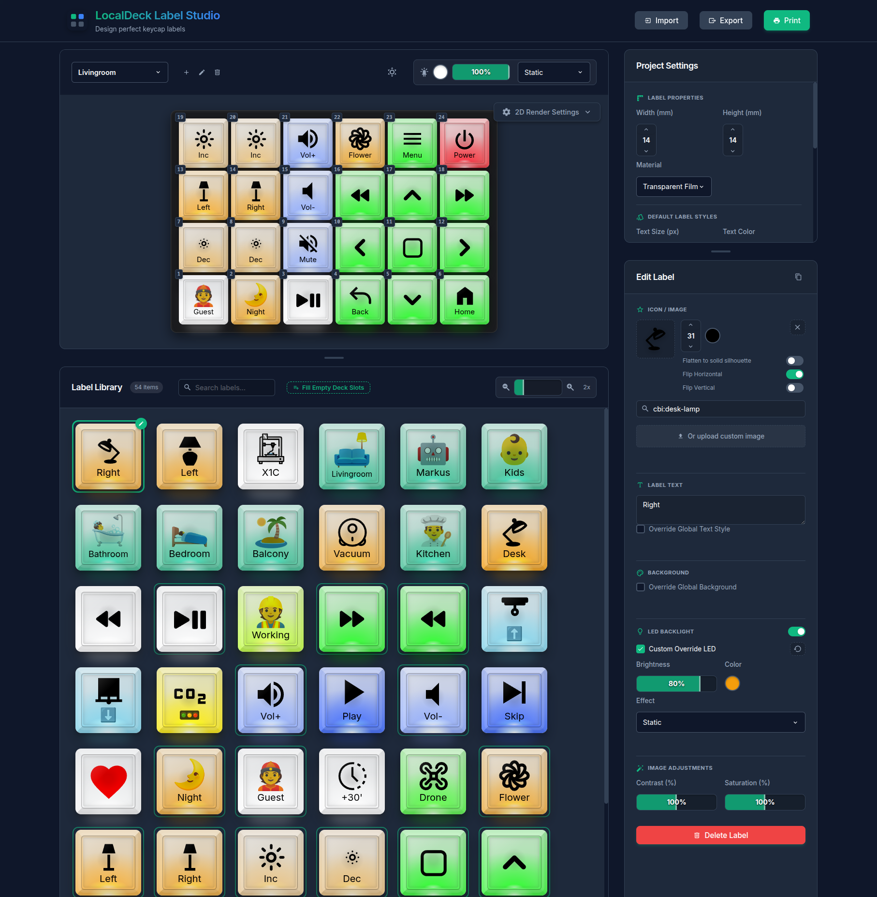

# LocalDeck Label Studio

A browser-based tool for designing and printing labels for LocalDeck macro pads that use Cherry MX
relegendable keycaps. Lay out your deck, design each label with text, icons, emoji or your own images,
preview how it looks backlit, and print a sheet of correctly sized labels with cut lines.

Everything runs locally in your browser. There is no backend and no account, and your work is
saved automatically in the browser's local storage.



## Features

- **Label design**
  - Text, [Iconify](https://icon-sets.iconify.design/) icons (Material Design Icons and many more sets),
    emoji, and uploaded images
  - Per-label overrides for text and icon size, color and position, background color,
    icon flipping and flattening; everything else inherits the global settings
  - Ctrl/Cmd+drag on a label to position its text or icon, with snapping to the center
- **Decks**
  - Several deck configurations with a configurable key matrix (6×4 by default)
  - Drag labels from the library onto deck slots to place them; drag between slots to move or swap them
  - One-click fill of empty slots with unused library labels
- **Preview**
  - 2D preview with LED backlight color, brightness and effects (static, breathing, rainbow), and
    label materials (transparent film, thin paper, thick paper)
  - Day and night room lighting
- **Printing**
  - A4 portrait, A4 landscape and US Letter sheets
  - Choose which labels to print per deck, arrange them on the sheet by drag and drop, with box selection
    for moving several at once
  - Dashed cut lines and an adjustable vertical offset to compensate for printer alignment
  - Prints without browser margins at the exact label size (14×14 mm by default)
- **Data**
  - Automatic saving in the browser
  - Export and import of the full project as JSON

## Getting started

Requires [Node.js](https://nodejs.org/) 22 (see `.nvmrc`); the tests need 22.22.2 or newer.

```sh
npm install
npm run dev
```

Then open http://localhost:5184.

If you use [just](https://github.com/casey/just), the same tasks are available as recipes (`just --list`).

## Printing tips

- Print at **100% scale** ("Actual size"). Do not use "Fit to page".
- If the labels are shifted vertically on paper, adjust the print offset in the print settings.
- 14×14 mm labels fit the relegendable cap once the cut line is trimmed off.

## Development

| Task | npm | just |
|---|---|---|
| Dev server with hot reload | `npm run dev` | `just dev` |
| Production build (to `dist/`) | `npm run build` | `just build` |
| Preview the production build | `npm run preview` | |
| Lint | `npm run lint` | `just lint` |
| Unit tests | `npm test` | `just test` |
| Coverage report | `npm run test:coverage` | `just coverage` |

Tech stack: Vue 3, Vite, plain JavaScript and CSS, Iconify, Vitest and ESLint.

Project layout:

- `src/composables/useStore.js`: global state, persistence and saved-data migrations
- `src/composables/usePrintCanvas.js`: print sheet interaction (pan, zoom, selection, drag and drop)
- `src/components/`: UI components, including the shared input components
  (`CustomSelect`, `CustomCheckbox`, `ColorPicker`, `NumberStepper`, …)
- `src/utils/`: pure helpers, for example `labelStyle.js`, which resolves per-label overrides against the
  global settings

Contributor and AI-agent guidelines are in [AGENTS.md](AGENTS.md).

The build uses relative asset paths (`base: './'`), so `dist/` can be hosted as-is on GitHub Pages or any
static file host.

### CI and deployment

- `.github/workflows/ci.yml` lints, tests (with coverage) and builds every push to `main` and every pull request.
- `.github/workflows/deploy.yml` runs the checks again and publishes `dist/` to GitHub Pages on every push
  to `main`. It needs **Settings → Pages → Source: GitHub Actions** in the repository.
- Dependabot opens weekly update PRs for npm packages and the workflows' actions.

## Credits

- Icons: [Iconify](https://iconify.design/)

## License

[GNU Affero General Public License v3.0](LICENSE)
