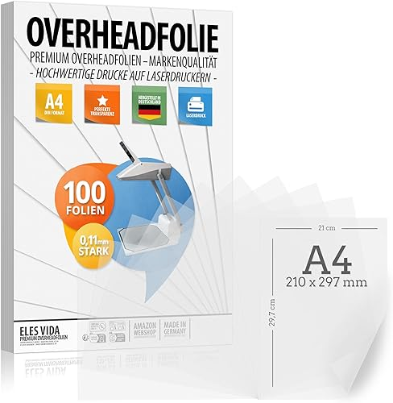
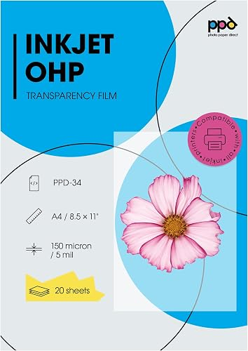
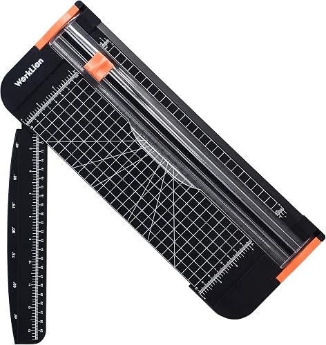

# LocalDeck Label Studio

A browser-based tool for designing and printing labels for
[LocalDeck](https://www.mylocalbytes.com/products/localdeck-set) macro pads that use Cherry MX
relegendable keycaps. Lay out your deck, design each label with text, icons, emoji or your own images,
preview how it looks backlit, and print a sheet of correctly sized labels with cut lines.

**Try it: https://markusressel.github.io/localdeck-label-studio/**

Everything runs locally in your browser. There is no backend and no account, and your work is
saved automatically in the browser's local storage.

## Features

- **Label design**
  - Text, [Iconify](https://icon-sets.iconify.design/) icons (Material Design Icons and many more sets),
    emoji, and uploaded images
  - Per-label overrides for text and icon size, color and position, background color,
    icon flipping and flattening; everything else inherits the global settings
  - Ctrl/Cmd+drag on a label to position its text or icon, with snapping to the center
- **Decks**
  - Several deck configurations with a configurable key matrix (6×4 by default)
  - Drag labels from the library onto deck slots to place them; drag between slots to move or swap them
  - One-click fill of empty slots with unused library labels
- **Preview**
  - 2D preview with LED backlight color, brightness and effects (static, breathing, rainbow), and
    label materials (transparent film, thin paper, thick paper)
  - Day and night room lighting
- **Printing**
  - A4 portrait, A4 landscape and US Letter sheets
  - Choose which labels to print per deck, arrange them on the sheet by drag and drop, with box selection
    for moving several at once
  - Dashed cut lines and an adjustable vertical offset to compensate for printer alignment
  - Prints without browser margins at the exact label size (14×14 mm by default)
- **Data**
  - Automatic saving in the browser
  - Export and import of the full project as JSON

## Related

- [LocalDeck](https://www.mylocalbytes.com/products/localdeck-set): the macro pad itself, by LocalBytes.
- [Official LocalDeck Configurator](https://blog.mylocalbytes.com/tools/localdeck-configurator): LocalBytes' own
  configurator. It is less sophisticated, but it supports their official Home Assistant integration, which
  this tool does not.

## Usage

Open **https://markusressel.github.io/localdeck-label-studio/** in your browser. Nothing needs to be
installed.

## Printing and cutting

### Materials

Clear overhead projector film looks best: the LED shines through it like through the real cap, and the
unprinted areas stay transparent. Use film made for your printer type: inkjet film can melt in a laser
printer's hot fuser and damage it, and inkjet ink does not dry on laser film.

<table>
  <tr>
    <td align="center" width="33%">
       
      <b>Laser printer: overhead film</b> 
      e.g. ELES VIDA "Overheadfolie Premium", A4, 0.11 mm, 100 sheets
      (<a href="https://www.amazon.de/dp/B092KHJ383">Amazon</a>). 
      The best result: very clear and sharp.
    </td>
    <td align="center" width="33%">
       
      <b>Inkjet printer: transparency film</b> 
      e.g. PPD "Inkjet OHP Transparency Film" PPD-34, A4, 150 µm, 20 sheets
      (<a href="https://www.amazon.de/dp/B00PFW935Q">Amazon</a>). 
      Works, but is less transparent and less sharp than laser film.
    </td>
    <td align="center" width="33%">
       
      <b>Cutting: paper trimmer</b> 
      e.g. WORKLION A4 paper trimmer with safety blade, 30.5 cm
      (<a href="https://www.amazon.de/dp/B07MP9JQ4W">Amazon</a>). 
      Gives straight, repeatable cuts, much easier than scissors.
    </td>
  </tr>
</table>

Paper also works (choose thin or thick paper as the material in the app to preview it), but lets less of
the LED light through.

### Printing

- Print at **100% scale** ("Actual size"). Do not use "Fit to page".
- If the labels are shifted vertically on paper, adjust the print offset in the print settings.

### Cutting

- Cut along the dashed cut lines, first into strips, then into single labels.
- 14×14 mm labels fit the relegendable cap once the cut line is trimmed off.

Product images are © their manufacturers and are shown only to identify the products.

## Contributing

See [CONTRIBUTING.md](CONTRIBUTING.md) for running the project locally, the development tasks and how CI
and deployment work.

## Credits

- Icons: [Iconify](https://iconify.design/)

## License

[GNU Affero General Public License v3.0](LICENSE)
